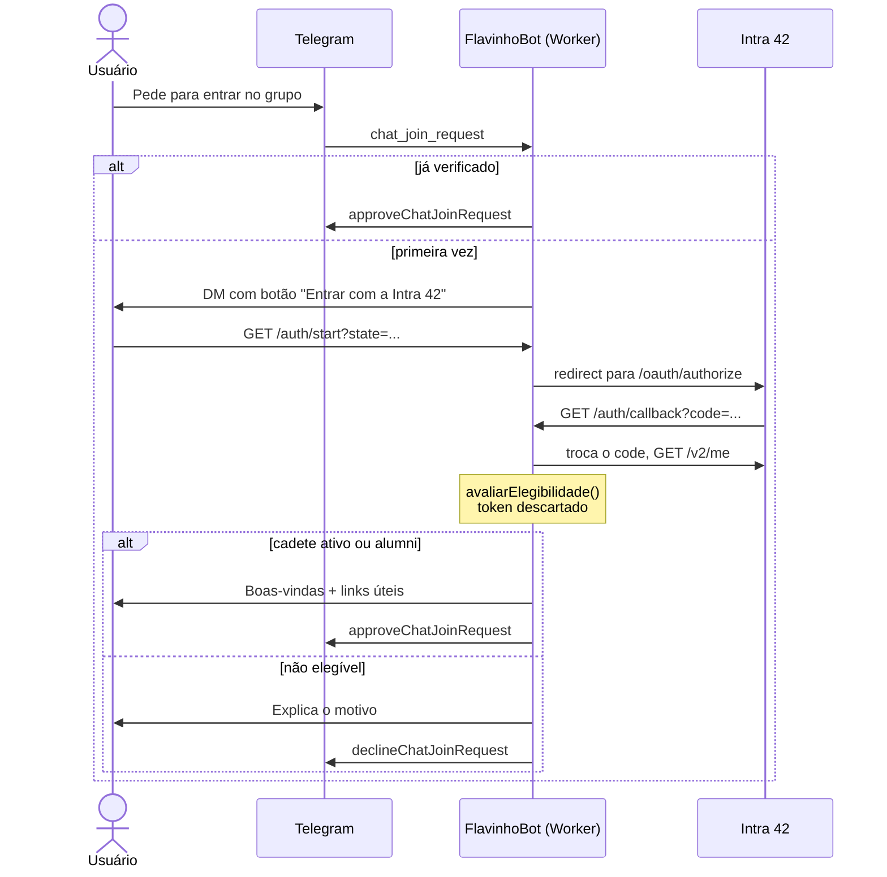

<div align="center">

# FlavinhoBot

**O porteiro da 42 Comunidade no Telegram.**

Só entra nos grupos quem prova, pelo login oficial da Intra 42, que é cadete ativo do 42cursus ou alumni.

[](https://github.com/herom-s/FlavinhoBot/actions/workflows/deploy.yml)


[Como funciona](#como-funciona) · [Deploy](docs/DEPLOY.md) · [Arquitetura](docs/ARCHITECTURE.md) · [Contribuindo](CONTRIBUTING.md)

</div>

---

A 42 Comunidade reúne estudantes da 42 São Paulo em cerca de 19 grupos temáticos (Geral, Carreira, Eventos, Moradia, clubes...). No Telegram, o FlavinhoBot fica na porta: quem pede para entrar faz login na Intra, o bot confere o cursus e libera ou recusa na hora.

Pisciners, quem caiu no blackhole e pessoas de fora ficam do lado de fora. Nas palavras do Flavinho: _"Tá elegante hoje, hein, jovem? Cadê o cordão?"_

## O que ele faz

- **Verifica pela Intra 42** com OAuth2. O bot nunca vê a senha e descarta o token logo depois de ler o perfil.
- **Aprova pedidos de entrada sozinho.** Quem já verificou entra direto em qualquer grupo da comunidade.
- **Gera convites de uso único** (válidos por 15 minutos) para quem começa pelo `/start` no privado.
- **Revalida todo dia.** Quem caiu no blackhole é reportado aos admins ou removido sem banimento, conforme a configuração.
- **Cobra quem entrou antes do bot**, com aviso fixado e prazo para verificar.
- **Respeita a LGPD:** guarda só o mínimo, explica tudo em `/privacidade` e apaga tudo com `/apagar_dados`.
- **Custa zero:** roda no plano gratuito do Cloudflare Workers, com D1 como banco.

## Como funciona



As regras de elegibilidade ficam numa função pura, [`avaliarElegibilidade()`](src/domain/eligibility.ts):

| Situação na Intra                                     | Resultado    |
| ----------------------------------------------------- | ------------ |
| Alumni (`alumni? = true`)                             | entra        |
| 42cursus iniciado, sem blackhole vencido, conta ativa | entra        |
| Staff, se `ALLOW_STAFF=true`                          | entra        |
| Só C Piscine, sem 42cursus                            | fica de fora |
| Blackhole vencido ou cursus encerrado                 | fica de fora |
| 42cursus ainda não começou                            | fica de fora |
| Campus fora de `ALLOWED_CAMPUS_IDS`                   | fica de fora |

Admins podem abrir exceções com `/allow` e bloquear com `/deny`.

## Comandos

**No privado com o bot**

| Comando         | O que faz                                                                      |
| --------------- | ------------------------------------------------------------------------------ |
| `/start`        | explica o bot e inicia a verificação (ou entrega os convites, se já verificou) |
| `/status`       | mostra se você está verificado e até quando                                    |
| `/grupos`       | lista os grupos da comunidade e do que cada um trata                           |
| `/links`        | links úteis da comunidade                                                      |
| `/privacidade`  | quais dados o bot guarda e por quê                                             |
| `/apagar_dados` | apaga seus dados e tira você dos grupos                                        |
| `/ajuda`        | como falar com um admin                                                        |
| `/help`         | lista os comandos                                                              |

**Para admins** (só no privado ou no chat de admins; para os outros, o bot não responde)

| Comando                   | O que faz                                                                                     |
| ------------------------- | --------------------------------------------------------------------------------------------- |
| `/help`                   | lista os comandos de admin                                                                    |
| `/stats`                  | membros por status, pendentes, negados em 7 dias, e por grupo: total, com cordão e sem cordão |
| `/quem <@user \| login>`  | situação de um membro                                                                         |
| `/allow <login> <motivo>` | libera um caso especial                                                                       |
| `/deny <login> <motivo>`  | bloqueia e remove dos grupos                                                                  |
| `/reverificar <login>`    | revalida agora na Intra                                                                       |
| `/pendentes`              | pedidos de entrada esperando verificação                                                      |
| `/sincronizar`            | confere se o bot tem as permissões certas em cada grupo                                       |
| `/proteger`               | protege um grupo onde o bot é admin (também por botão, quando o bot vira admin)               |
| `/desproteger`            | deixa de proteger um grupo                                                                    |
| `/nao_verificados`        | quem foi visto nos grupos e ainda não verificou                                               |
| `/avisar`                 | fixa nos grupos o aviso para membros antigos verificarem                                      |
| `/admins`                 | lista donos e admins do bot                                                                   |
| `/novo_admin`             | torna alguém admin (respondendo uma mensagem, ou por id ou @)                                 |
| `/remover_admin`          | tira alguém de admin                                                                          |
| `/chatid`                 | mostra o ID do chat (útil no setup)                                                           |

No chat de admins, o @ do bot nos comandos é opcional: `/stats` e `/stats@<bot>` funcionam igual. Quem não é admin e manda `/help` ali recebe o próprio ID e um botão **➕ Tornar admin** que qualquer admin pode tocar. Os donos (`ADMIN_IDS`) são fixos; os demais admins e os grupos protegidos são gerenciados pelo próprio Telegram.

**Nos grupos protegidos**

| Comando | O que faz                                                                                                |
| ------- | -------------------------------------------------------------------------------------------------------- |
| `/help` | explica o que é o bot e o que dá pra fazer no privado (no máximo 1 resposta por minuto para cada pessoa) |

O menu "/" do Telegram mostra a lista certa em cada lugar: comandos de usuário no privado, comandos de admin no chat de admins e no privado dos admins, e só o `/help` nos grupos.

## Começando

Para desenvolver localmente você precisa de [Bun](https://bun.sh) e Node 22.5 ou mais novo (os testes usam `node:sqlite`).

```bash
git clone git@github.com:herom-s/FlavinhoBot.git
cd FlavinhoBot
bun install
bun run test
```

Para colocar no ar com o seu próprio bot, app da Intra e conta Cloudflare, siga o **[guia de deploy](docs/DEPLOY.md)**. Ele vai do `/newbot` no BotFather até o primeiro grupo protegido.

## Stack

| Peça                | Escolha                                                |
| ------------------- | ------------------------------------------------------ |
| Linguagem           | TypeScript 7 (strict)                                  |
| Bot                 | [grammY](https://grammy.dev), via webhook              |
| Hospedagem          | Cloudflare Workers, plano gratuito                     |
| Banco               | Cloudflare D1 (SQLite), com migrations versionadas     |
| Tarefas agendadas   | Cron Triggers (1x por dia)                             |
| Validação de config | zod                                                    |
| Testes              | Vitest, com o repositório D1 real rodando sobre SQLite |
| Tooling             | Bun, ESLint, Prettier, GitHub Actions                  |

Detalhes de fluxo, segurança, limites do plano gratuito e decisões de projeto estão em **[ARCHITECTURE.md](docs/ARCHITECTURE.md)**.

## Privacidade

O bot guarda: ID e @ do Telegram, login e ID da Intra, status (cadete, alumni, staff ou liberação manual), campus e as datas de verificação e consentimento.

O bot não guarda: senha, tokens, e-mail, nome, foto, telefone ou notas. Registros de verificações negadas são apagados em até 90 dias.

## Contribuindo

Issues e pull requests são bem-vindos. Veja o [CONTRIBUTING.md](CONTRIBUTING.md) para rodar o projeto, os testes e o padrão de código.
